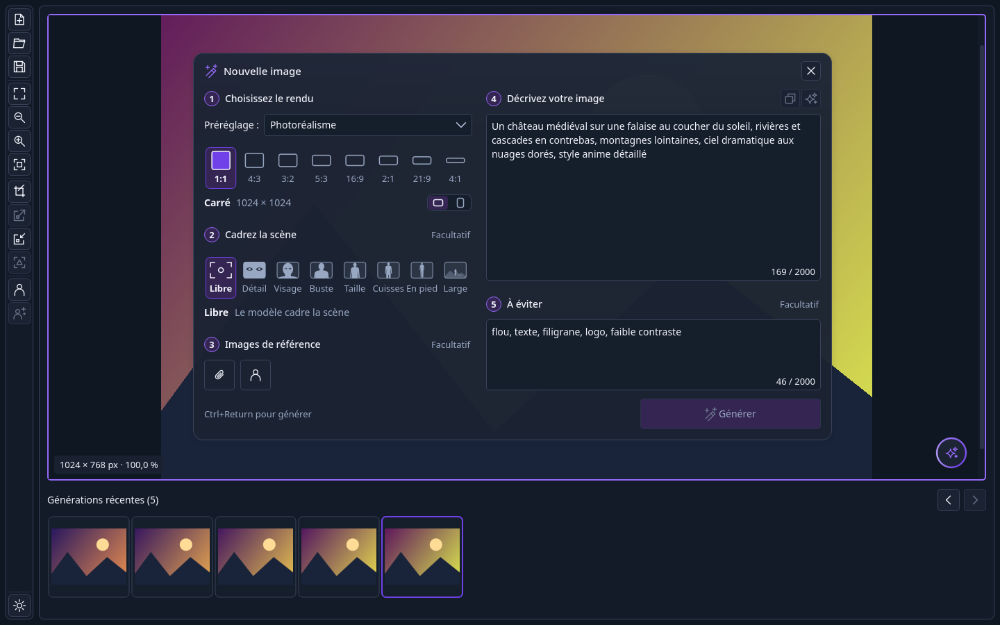
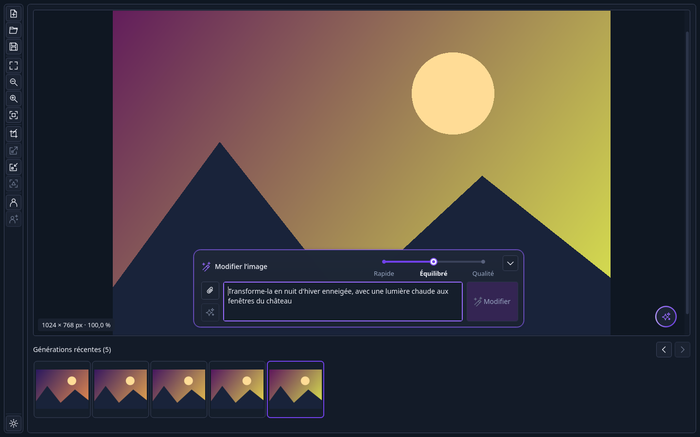
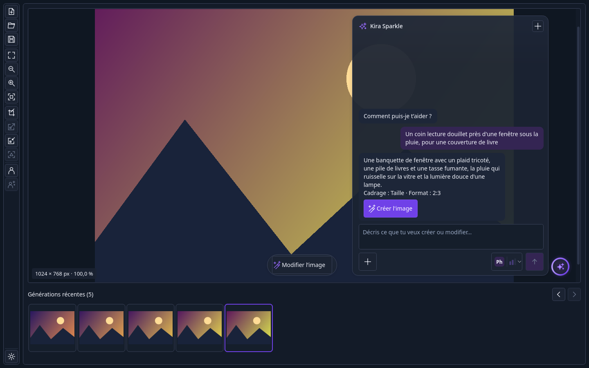
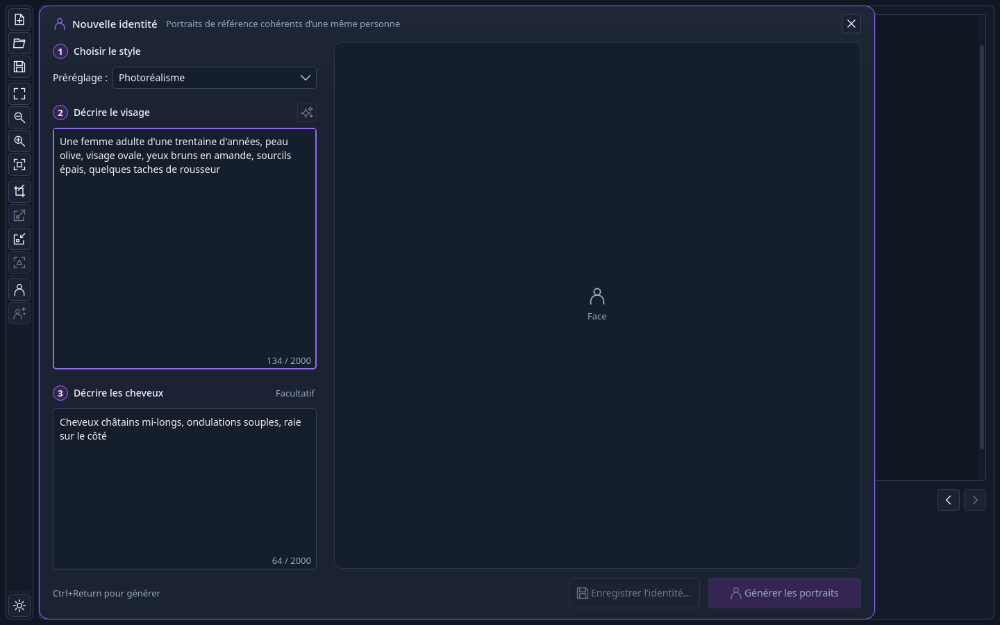

# Kaimera

[](https://github.com/jstmichel/kaimera/actions/workflows/ci.yml)
[](https://github.com/jstmichel/kaimera/releases/latest)
[](LICENSE)

*English: [README.md](README.md)*



Kaimera crée et retouche des images avec des modèles d'IA, sur votre propre matériel.
Décrivez une image, choisissez un rendu, un cadrage et un format, et il la génère ; ensuite,
modifiez-la d'une phrase, recadrez-la, agrandissez-la ou rendez-la plus nette, créez des
portraits cohérents d'une personne, ou demandez simplement à Kira Sparkle, son chat, ce que
vous avez en tête.

Kaimera est une application de bureau Qt 6 Widgets pour Linux, macOS et Windows. Les
modèles, le stockage et la file des tâches appartiennent à
[Nukleus](https://github.com/jstmichel/nukleus), un service qui tourne sur le même
ordinateur ou sur votre réseau local : Kaimera lui envoie les tâches et affiche les
résultats. Il parle français et anglais, selon la langue du système.

## Ce qu'il fait

- **Nouvelle image** : une carte guidée en cinq étapes : le rendu (un préréglage et des
  formats à l'échelle), le cadrage (du gros plan au plan large), jusqu'à quatre images de
  référence, la description et ce qu'il faut éviter. Les générations attendent leur tour
  sur le service, chacune derrière une vignette de progression dans l'historique de la
  session.
- **Retouche** : une bulle de modification au-dessus de l'aperçu, en qualité Rapide,
  Équilibré ou Qualité, avec des images de référence ; recadrage, agrandissement 2×,
  réduction 2× et une passe de netteté légère dans la barre d'outils.
- **Animation** : **Animer**, dans la barre d'outils, transforme l'image sélectionnée en
  courte vidéo à partir d'une description du mouvement, éventuellement vers une image de
  fin et en boucle sans coupure. Elle se lit dans l'aperçu, attend son tour dans
  l'historique de la session comme une génération et s'enregistre en MP4, lisible partout.
- **Identités** : des portraits de face, de profil et de trois quarts d'une même personne à
  partir d'une description écrite, enregistrés dans un paquet `.kiraid`, puis joints aux
  nouvelles images ou appliqués aux retouches.
- **Kira Sparkle** : un chat qui comprend une demande, pose une question quand elle est
  floue, propose une image avec son cadrage, son format et son prompt, et la crée quand
  vous acceptez.
- **Aide aux prompts** : écrivez dans n'importe quelle langue ; les prompts sont traduits
  en anglais avant la génération, ✨ rend un texte plus précis et mieux structuré, et les
  modèles à tags reçoivent des tags Danbooru.

| Retoucher d'une phrase | Kira Sparkle | Une nouvelle identité |
|---|---|---|
|  |  |  |

Chaque écran est décrit dans le [guide d'utilisation](docs/user-guide.md) (en anglais).

## État

Version 0.3.0. Notes de version :
[docs/release-notes/0.3.0.md](docs/release-notes/0.3.0.md) (en anglais). La CI compile et
teste sous Linux ; les versions macOS et Windows restent à vérifier sur de vrais bureaux.

## Prérequis

- Un service [Nukleus](https://github.com/jstmichel/nukleus) 0.1 avec un modèle d'image pour
  chaque préréglage et chaque qualité de retouche. Un LLM désigné traducteur et
  améliorateur de prompt par défaut active la traduction, ✨ et Kira Sparkle. L'animation
  demande Nukleus 0.3 avec ffmpeg et un modèle d'animation.
- Pour compiler : CMake 3.24+, un compilateur C++20, Qt 6.5+ (Widgets, Network, WebSockets,
  SVG, Multimedia avec son moteur FFmpeg, LinguistTools) et LibArchive. Sous Arch Linux :
  `sudo pacman -S --needed base-devel git cmake ninja qt6-base qt6-websockets qt6-svg qt6-multimedia qt6-multimedia-ffmpeg qt6-tools libarchive`.
  [CONTRIBUTING.md](CONTRIBUTING.md) donne les paquets Debian, Fedora et macOS.

## Installation

### Depuis une version publiée (une commande)

```sh
curl -fsSL https://github.com/jstmichel/kaimera/releases/latest/download/get-kaimera.sh | sh
```

Le script télécharge la dernière version, la vérifie avec le `SHA256SUMS` de la version
publiée, la compile, lance ses tests et seulement ensuite l'installe dans `~/.local`
(`~/Applications` sous macOS). [Ardoise](https://github.com/jstmichel/ardoise) et le SDK
Nukleus sont utilisés s'ils sont installés ; sinon, CMake récupère leurs versions
épinglées. Options : `--version v0.1.0`, `--prefix <dossier>`, `--qt <dossier>`, `--dry-run`
(à passer avec `| sh -s -- --dry-run`). Lisez-le d'abord si vous le souhaitez :
[scripts/get-kaimera.sh](scripts/get-kaimera.sh).

### Depuis ce dépôt

```sh
cmake -S . -B build -G Ninja -DCMAKE_INSTALL_PREFIX="$HOME/.local"
cmake --build build
ctest --test-dir build --output-on-failure
cmake --install build
```

Lancez **Kaimera** depuis le lanceur d'applications, ou avec `kaimera` (`kaimera --version`
affiche sa version). Un dépôt voisin `../nukleus` sert au SDK quand il existe.
[CONTRIBUTING.md](CONTRIBUTING.md) décrit la compilation de développement, les tests et le
débogage.

## Premier lancement

1. Ouvrez les **Préférences du service** avec la roue dentée en bas de la barre d'outils,
   saisissez l'adresse du service Nukleus (`localhost`, ou son adresse IPv4 sur votre
   réseau) et son jeton, puis **Enregistrer**.
2. Cliquez sur **Nouvelle image** dans la barre d'outils, décrivez votre image et appuyez
   sur **Générer** (Ctrl+Entrée).

En option, pour les modèles à tags Danbooru, placez le `danbooru.csv` de tagcomplete dans
le dossier de données de Kaimera, pour que les tags aient leur orthographe exacte :

```sh
curl -L -o ~/.local/share/Kaimera/Kaimera/danbooru.csv \
  https://raw.githubusercontent.com/DominikDoom/a1111-sd-webui-tagcomplete/main/tags/danbooru.csv
```

## Réglages et données

Kaimera garde ses préférences dans les réglages Qt de Kaimera
(`~/.config/Kaimera/Kaimera.conf` sous Linux) et les images en mémoire le temps de la
session : il ne parcourt jamais vos dossiers et n'exporte rien sans un Enregistrer.
Kaimera s'appelait Kira Canvas : à son premier lancement, il copie les réglages et le
dictionnaire Danbooru enregistrés sous ce nom, sans y toucher.

Pour désinstaller une installation utilisateur, supprimez `~/.local/bin/kaimera`,
`~/.local/share/applications/me.kodara.kaimera.desktop` et les icônes `me.kodara.kaimera.png`
sous `~/.local/share/icons/hicolor/` (sous macOS, `~/Applications/kaimera.app`), puis, si
vous le souhaitez, les réglages et `~/.local/share/Kaimera/`.

## Contribuer

Les idées et les bogues vont dans les [issues](https://github.com/jstmichel/kaimera/issues) ;
les problèmes de modèles, d'installation ou de file des tâches relèvent de
[Nukleus](https://github.com/jstmichel/nukleus/issues). Kaimera avance par petites étapes
testées. Voir [CONTRIBUTING.md](CONTRIBUTING.md) (en anglais).

## Licence

MIT, voir [LICENSE](LICENSE).
