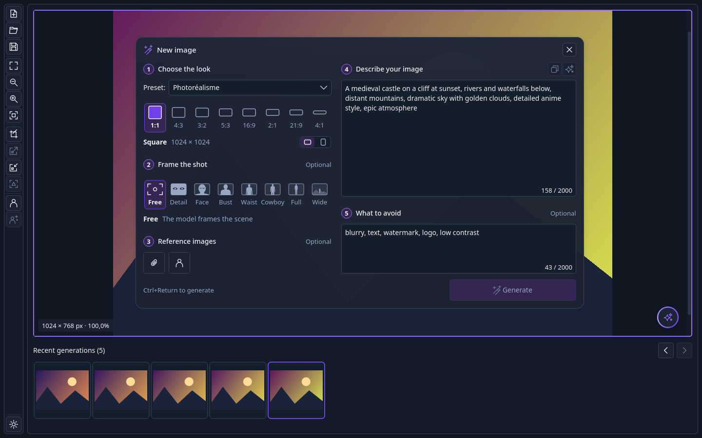
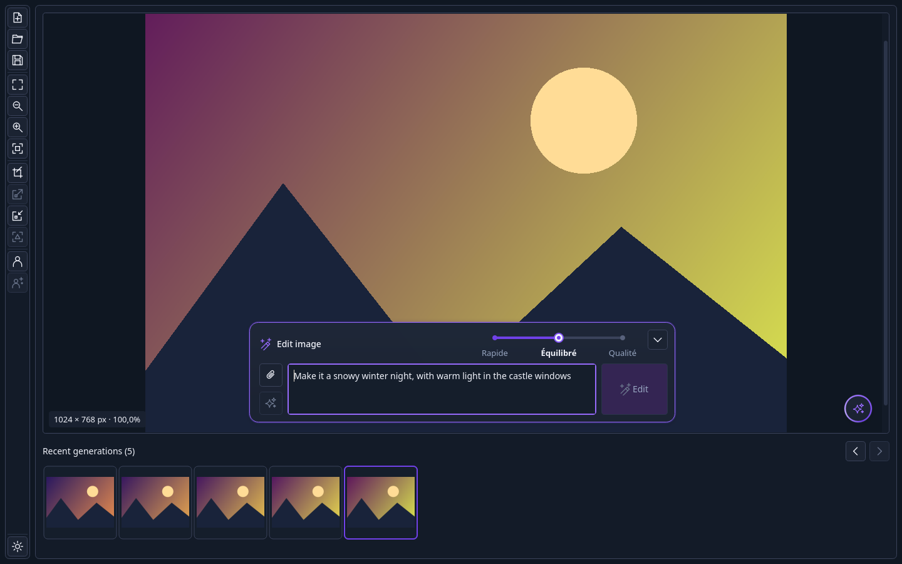
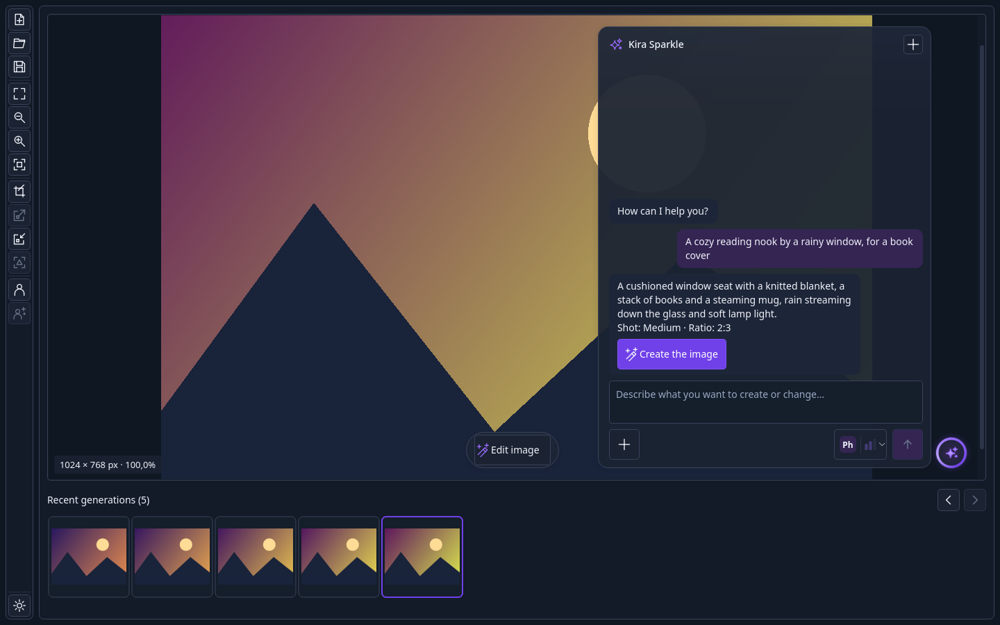
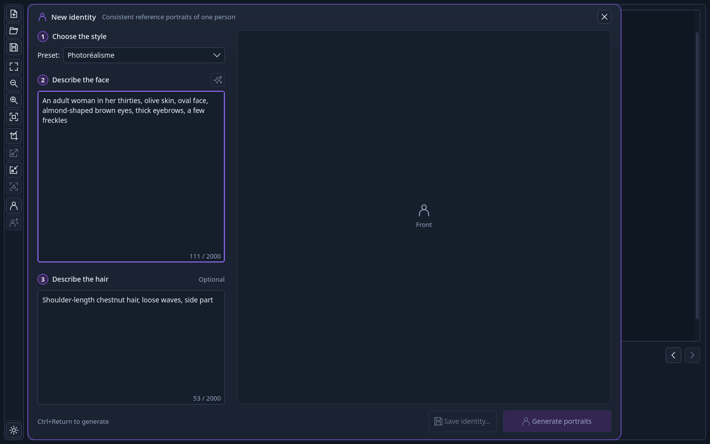

# Kaimera

[](https://github.com/jstmichel/kaimera/actions/workflows/ci.yml)
[](https://github.com/jstmichel/kaimera/releases/latest)
[](LICENSE)

*Français : [README.fr.md](README.fr.md)*



Kaimera creates and edits images with AI models on your own hardware. Describe an image,
pick a look, a camera shot and a format, and it generates; then edit it with a sentence,
crop, upscale or sharpen it, build consistent portraits of a person, or simply ask Kira
Sparkle, its chat, for what you have in mind.

Kaimera is a Qt 6 Widgets desktop application for Linux, macOS and Windows. Models, storage
and the job queue belong to [Nukleus](https://github.com/jstmichel/nukleus), a service
running on the same computer or on your local network: Kaimera sends it jobs and shows the
results. It speaks English and French, following the language of the system.

## What it does

- **New image**: a guided card with five steps: the look (a preset and to-scale format
  tiles), the camera shot (close-up to wide), up to four reference images, the
  description and what to avoid. Generations queue on the service, each behind a progress
  tile in the session history.
- **Editing**: an edit bubble over the preview, with Fast, Balanced and Quality editing
  and reference images; crop, 2× upscale, 2× downscale and a light sharpening pass in the
  toolbar.
- **Identities**: front, profile and three-quarter portraits of one person from a written
  description, saved as a `.kiraid` package, then attached to new images or applied to
  edits.
- **Kira Sparkle**: a chat that understands a request, asks when it is vague, proposes an
  image with its shot, ratio and prompt, and creates it once you accept.
- **Prompt help**: write in any language; prompts are translated into English before
  generation, ✨ makes a text more precise and better structured, and tag-based models get
  Danbooru tags.

| Edit with a sentence | Kira Sparkle | A new identity |
|---|---|---|
|  |  |  |

Every screen is described in the [user guide](docs/user-guide.md).

## Status

Version 0.1.0, the first release. Release notes:
[docs/release-notes/0.1.0.md](docs/release-notes/0.1.0.md). CI builds and tests on Linux;
macOS and Windows builds still need checks on real desktops.

## Requirements

- A [Nukleus](https://github.com/jstmichel/nukleus) 0.1 service with an image model for
  each preset and editing quality. An LLM marked as default prompt translator and enhancer
  enables translation, ✨ and Kira Sparkle.
- To build: CMake 3.24+, a C++20 compiler, Qt 6.5+ (Widgets, Network, WebSockets, SVG,
  LinguistTools) and LibArchive. On Arch Linux:
  `sudo pacman -S --needed base-devel git cmake ninja qt6-base qt6-websockets qt6-svg qt6-tools libarchive`.
  [CONTRIBUTING.md](CONTRIBUTING.md) lists the Debian, Fedora and macOS packages.

## Installation

### From a release (one command)

```sh
curl -fsSL https://github.com/jstmichel/kaimera/releases/latest/download/get-kaimera.sh | sh
```

The script downloads the latest release, checks it against the release's `SHA256SUMS`,
builds it, runs its tests and only then installs it under `~/.local` (`~/Applications` on
macOS). [Ardoise](https://github.com/jstmichel/ardoise) and the Nukleus SDK are used when
installed, otherwise CMake fetches their pinned versions. Options: `--version v0.1.0`,
`--prefix <dir>`, `--qt <dir>`, `--dry-run` (pass them with `| sh -s -- --dry-run`). Read it
first if you like: [scripts/get-kaimera.sh](scripts/get-kaimera.sh).

### From this checkout

```sh
cmake -S . -B build -G Ninja -DCMAKE_INSTALL_PREFIX="$HOME/.local"
cmake --build build
ctest --test-dir build --output-on-failure
cmake --install build
```

Start **Kaimera** from the application launcher, or run `kaimera` (`kaimera --version`
prints its version). A sibling `../nukleus` checkout is used for the SDK when present.
[CONTRIBUTING.md](CONTRIBUTING.md) covers development builds, tests and debugging.

## First start

1. Open **Service Preferences** with the cog at the bottom of the toolbar, enter the
   address of the Nukleus service (`localhost`, or its IPv4 address on your network) and
   its token, then **Save**.
2. Click **New Image** in the toolbar, describe your image and press **Generate**
   (Ctrl+Return).

Optionally, for Danbooru-tag models, put the tagcomplete `danbooru.csv` in Kaimera's data
folder so that tags get their exact spelling:

```sh
curl -L -o ~/.local/share/Kaimera/Kaimera/danbooru.csv \
  https://raw.githubusercontent.com/DominikDoom/a1111-sd-webui-tagcomplete/main/tags/danbooru.csv
```

## Settings and data

Kaimera keeps its preferences in the Qt settings for Kaimera (`~/.config/Kaimera/Kaimera.conf`
on Linux) and images in memory for the session: it never scans folders or exports anything
without a Save. Kaimera was named Kira Canvas: on its first start it copies the settings and
the Danbooru dictionary saved under that name, and leaves them in place.

To uninstall a user installation, remove `~/.local/bin/kaimera`,
`~/.local/share/applications/me.kodara.kaimera.desktop` and the `me.kodara.kaimera.png`
icons under `~/.local/share/icons/hicolor/` (on macOS, `~/Applications/kaimera.app`), then,
if you like, the settings and `~/.local/share/Kaimera/`.

## Contributing

Ideas and bugs go to the [issues](https://github.com/jstmichel/kaimera/issues); problems
with models, installation or the job queue belong to
[Nukleus](https://github.com/jstmichel/nukleus/issues). Kaimera grows in small, tested
slices. See [CONTRIBUTING.md](CONTRIBUTING.md).

## License

MIT, see [LICENSE](LICENSE).
